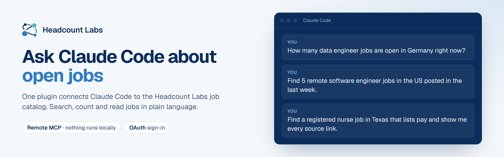

<p align="center">
  <a href="https://headcountlabs.com/mcp/">
    <picture>
      <source media="(prefers-color-scheme: dark)" srcset=".github/assets/banner-dark.png">
      
    </picture>
  </a>
</p>

<p align="center">
  <a href="https://headcountlabs.com/mcp/"><b>Setup and docs</b></a> ·
  <a href="https://headcountlabs.com/docs/mcp-tools/"><b>MCP tools</b></a> ·
  <a href="https://headcountlabs.com/pricing/"><b>Pricing</b></a> ·
  <a href="https://headcountlabs.com/privacy/"><b>Privacy</b></a>
</p>

Headcount Labs reads open jobs from employers' own career sites and job boards, merges copies of the same job, and
keeps a link to every source posting. This plugin connects Claude Code to the Headcount Labs job search server, so you
can ask Claude about open jobs in plain language.

## Install

In Claude Code, run:

```
/plugin install headcount-labs --marketplace headcountlabs/claude-plugin
```

Or add the marketplace first, then install from it:

```
/plugin marketplace add headcountlabs/claude-plugin
/plugin install headcount-labs@headcountlabs
```

Without the plugin, you can add the server yourself:

```bash
claude mcp add --transport http headcount-labs "https://api.headcountlabs.com/mcp?profile=claude"
```

## What you can ask

- "How many data engineer jobs are open in Germany right now?"
- "Find 5 remote software engineer jobs in the US posted in the last week."
- "Find a registered nurse job in Texas that lists pay and show me every source link."

Claude answers with each job's title, employer, location, pay as the employer published it, and the link to the
original posting, so you can check it and apply there.

## Tools Claude uses

| Tool | What it does |
| --- | --- |
| `search_jobs` | Finds jobs by keywords, location, pay, work arrangement, dates and other filters |
| `count_jobs` | Counts matching jobs without fetching them |
| `get_job` | Reads one job's full record, with every linked source posting |
| `list_fields` | Finds the right filter or field for a keyword such as "pay" or "remote" |
| `search_docs` | Answers questions about Headcount Labs from its docs |
| `get_usage` | Shows what you have used and what is left this month |

The [MCP tools page](https://headcountlabs.com/docs/mcp-tools/) lists every tool and what it does.

## What the plugin contains

- `.mcp.json` adds one remote MCP server, `https://api.headcountlabs.com/mcp?profile=claude`. Nothing runs on your
  machine.
- `skills/find-jobs` tells Claude which tool fits which question and to show the posting link with each job.

## Sign-in, pricing and data

The first time Claude uses the server, Claude Code opens a Headcount Labs sign-in page (OAuth). No API key is needed
and nothing is stored in this plugin.

Every organization gets 100,000 records free each calendar month (UTC), with no card needed. After that, you pay for
the records delivered. The [pricing page](https://headcountlabs.com/pricing/) has the rates.

Claude sends your search filters and questions to api.headcountlabs.com and receives job data back. Headcount Labs does
not store the searches or full tool inputs your assistant sends, and keeps only the usage counts needed for billing
([privacy policy](https://headcountlabs.com/privacy/)).

The tools read job data, with two exceptions. `set_confirmation_level` changes one account setting, how large a search
can be before Claude must ask you first. `verify_jobs` has the Headcount Labs server re-open a small sample of the
original postings to check that they match. The plugin can't apply to jobs, contact employers or change your plan.

## More from Headcount Labs

- [REST API docs](https://headcountlabs.com/docs/) for your own code.
- [Open dataset](https://huggingface.co/datasets/HeadcountLabs/job-postings) on Hugging Face, CC BY 4.0.
- [career-ops plugin](https://github.com/HeadcountLabs/career-ops-plugin-headcountlabs) for job searches in career-ops.

## Support

[headcountlabs.com/contact](https://headcountlabs.com/contact/) or support@headcountlabs.com.
[Terms](https://headcountlabs.com/terms/) · [Privacy](https://headcountlabs.com/privacy/) · MIT license.
